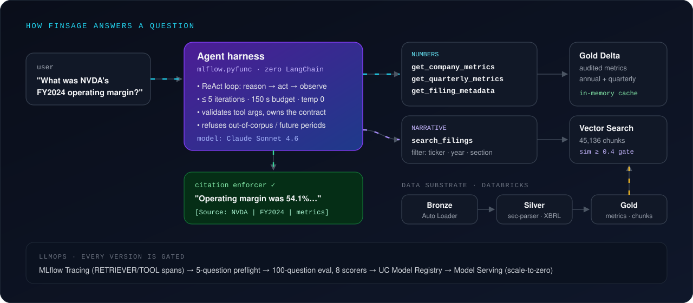
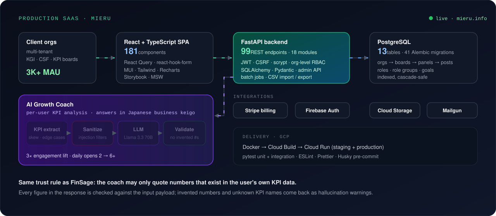

<a href="https://github.com/gulaag/FinSage">
  
</a>

<p align="center">
  <a href="https://github.com/gulaag/FinSage">
    
  </a>
</p>

<p align="center">
  <a href="https://linkedin.com/in/digvijayarsaga"></a>
  <a href="mailto:digvijay21251@iiitd.ac.in"></a>
  <a href="https://github.com/gulaag/FinSage"></a>
  <a href="https://github.com/gulaag/mieru-case-study"></a>
</p>

<br>

## 🧠 About me

```python
class DigvijaySingh(AIEngineer):
    now        = "AI & Software Engineer @ Arsaga Partners (Japan)"
    builds     = ["tool-calling agents", "production RAG", "LLM eval harnesses", "backends at scale"]
    certified  = ["Databricks Generative AI Engineer Associate", "Databricks Data Engineer Professional"]
    education  = "B.Tech, Computer Science & Applied Mathematics, IIIT Delhi"

    def principle(self):
        return "A number without a source is worthless. Ground it, cite it, or refuse."
```

I take LLM agents from notebook to production: the **orchestration loop**, the **retrieval layer**, the **guardrails**, and the **evaluation harness** that proves a new version is better before it ships. I also build the backend and data platforms they run on.

<table>
<tr>
<td width="33%" valign="top">

### 🤖 Agentic AI
Function-calling agents with an **owned harness** (no LangChain): bounded ReAct loops, JSON-schema tools, argument validation, refusal policies, citation enforcement.

</td>
<td width="33%" valign="top">

### 🔎 Retrieval & Evals
ANN **semantic search** with metadata filters and similarity gates, section-aware chunking, **LLM-as-a-judge** plus programmatic scorers, run-over-run regression diffs.

</td>
<td width="33%" valign="top">

### 🏗️ Scalable systems
FastAPI services, PostgreSQL, multi-tenant RBAC, Spark / Delta Lake **Medallion** pipelines, Docker on Cloud Run, Databricks Asset Bundles, CI/CD.

</td>
</tr>
</table>

<br>

## ⭐ Flagship: [FinSage](https://github.com/gulaag/FinSage), an agentic financial analyst over SEC filings

<a href="https://github.com/gulaag/FinSage">
  
</a>

A tool-calling agent that answers questions about 30 large-cap companies from **728 SEC 10-K / 10-Q filings**, and backs every figure with the filing, fiscal year and section it came from. Piloted with **1,000 retail investors in Japan**; Arsaga then formed a dedicated team to productize it.

<a href="https://github.com/gulaag/FinSage">
  
</a>

- **Numbers never come from RAG.** Figures are served only by metric tools over audited Gold tables; vector search handles narrative. That split is why hallucinated numbers are close to zero.
- **Owned agent harness.** A ReAct-style loop in `mlflow.pyfunc` (≤ 5 iterations, 150 s budget, temperature 0) where the harness, not the model, validates arguments, runs tools and enforces the output contract.
- **Retrieval with a quality gate.** Metadata-filtered ANN search over 45,136 BGE-large chunks with a 0.4 similarity gate and a single permissive retry.
- **Evals as a release gate.** 100 stratified, SEC-verified questions; 8 scorers (±1% numeric tolerance, tool routing, refusal reason, citation format, retrieval groundedness, two LLM judges); results persisted to Delta with dataset hash and git commit for regression diffs across agent versions.
- **Production plumbing.** MLflow Tracing on every tool call, Unity Catalog model registry, scale-to-zero Model Serving, Databricks Asset Bundles, GitHub Actions with OAuth M2M (no PATs), Terraform cost guardrails.

<details>
<summary><b>Watch the Databricks pipeline run end to end</b> (Bronze → Silver → Gold → Vector index)</summary>
<br>

</details>

<p>
  
  
  
  
  
  
  
  
  
</p>

<br>

## 🏗️ Production at scale: [MIERU](https://github.com/gulaag/mieru-case-study), a multi-tenant KPI SaaS

<a href="https://github.com/gulaag/mieru-case-study">
  
</a>

[mieru.info](https://mieru.info) is a live KGI / CSF / KPI management platform used by Japanese companies (**3K+ MAU**). I built across the whole stack and shipped its generative-AI feature.

- **Backend:** 99 REST endpoints across 18 FastAPI modules, PostgreSQL schema of 13 tables and 41 Alembic migrations, org-level RBAC, JWT + CSRF, Stripe subscription billing.
- **Frontend:** a 181-component React + TypeScript app with React Query, Storybook and MSW-mocked tests.
- **AI Growth Coach:** personalized coaching on Llama 3.3 70B, self-hosted on Ollama at **4× lower latency than Groq**. Input passes through prompt-injection filters that block **98%** of attack payloads, and every number in the response is checked against the user's own data. **3× engagement lift** (daily opens 2 → 6+).
- **Delivery:** Docker images built by Cloud Build and deployed to Cloud Run (staging and production).

> The source is proprietary, so the repo is a [case study](https://github.com/gulaag/mieru-case-study) of the architecture and engineering decisions. Happy to walk through the code in an interview.

<br>

## 🧪 More work

| Project | What it is | Stack |
|---|---|---|
| 🤖 [**databricks-AIagent**](https://github.com/gulaag/databricks-AIagent) | Enterprise **action agent**: retrieves context from past sessions via Vector Search, drafts a Japanese announcement, posts it to Slack / Teams, and audit-logs every action to Unity Catalog. | MLflow PyFunc · Vector Search · Llama 3.3 70B · MLflow Tracing |
| 🏭 **Enterprise data platform** *(client work)* | OIDC-federated CI/CD for Databricks Asset Bundles on GCP: CI 20 → 5 min, deploys 45 → 8 min, compute cost −40%. Spark ETL on Delta Live Tables at 50K records/day. | Databricks · DLT · PySpark · Terraform · GitLab CI |
| 🎬 [**movie_recommender**](https://github.com/gulaag/movie_recommender) | Content-based recommender over 4,800 films using vectorized tags and cosine similarity, served with Streamlit. | scikit-learn · NLP · Streamlit |
| 📈 [**regression_DataCleaning**](https://github.com/gulaag/regression_DataCleaning) | End-to-end ML: preprocessing pipelines, stacked ensembles with GridSearchCV, Flask serving. | scikit-learn · XGBoost · CatBoost · Flask |

<br>

## 🛠️ Stack

<p align="center">
  
</p>

<table>
<tr><td><b>LLMs & agents</b></td><td>     </td></tr>
<tr><td><b>Retrieval & evals</b></td><td>   </td></tr>
<tr><td><b>Data platform</b></td><td>    </td></tr>
<tr><td><b>Backend</b></td><td>     </td></tr>
<tr><td><b>Frontend</b></td><td>  </td></tr>
<tr><td><b>Cloud & DevOps</b></td><td>      </td></tr>
</table>

<br>

## 🏆 Credentials

- 🎓 **Databricks Certified Generative AI Engineer Associate**
- 🎓 **Databricks Certified Data Engineer Professional**
- 🥇 **Winner**, Build with Claude hackathon (Arsaga)
- ⚔️ **Codeforces Expert** (max rating 1632)
- 📐 **JEE Main 98.9 percentile** (top 1% of 1.3M)

<br>

<p align="center">
  <b>Hiring for agentic AI, LLM platform or backend roles?</b> I'd love to talk.<br><br>
  <a href="https://linkedin.com/in/digvijayarsaga"></a>
  <a href="mailto:digvijay21251@iiitd.ac.in"></a>
</p>


